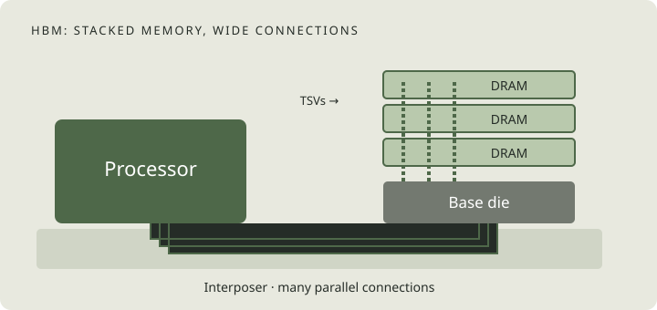
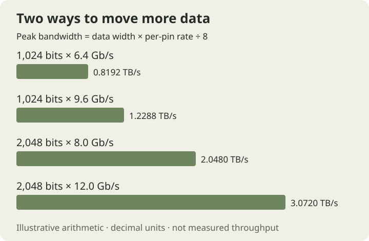
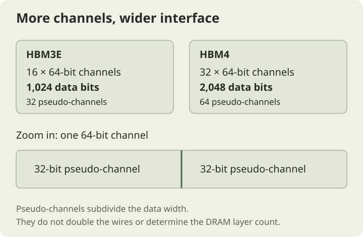
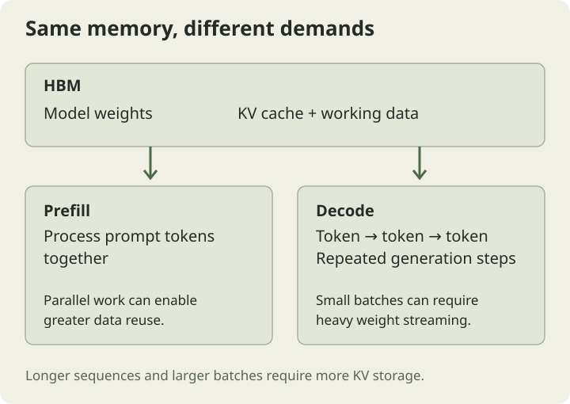
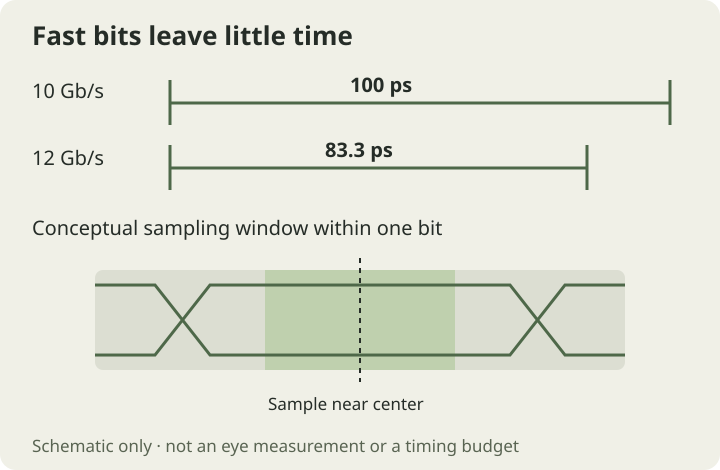

An AI accelerator can perform an enormous number of calculations and still spend time waiting. Its arithmetic units need a steady supply of weights, activations, and intermediate results. When data cannot arrive fast enough, adding more compute does little to accelerate the workload.

**High-Bandwidth Memory (HBM)** addresses this problem with stacked DRAM, a very wide data interface, and close integration with the processor. Understanding it means looking beyond a headline in terabytes per second: the memory organization, workload, electrical interface, and package all influence the result.

## Inside an HBM package

HBM places multiple DRAM dies in a vertical stack. **Through-silicon vias (TSVs)** provide electrical connections through the silicon, allowing signals to travel vertically between layers. Stacking puts substantial memory capacity into a small footprint. [SK’s introduction to HBM](https://eng.sk.com/perspectives/hbm-technology-the-silent-catalyst-of-the-ai-revolution) explains this basic architectural shift.

The stack sits near the accelerator, commonly on an interposer that provides dense wiring between them. A base die forms the bottom of the stack; its implementation and functions depend on the generation and product. The processor-side memory controller schedules accesses, while the physical interface, or **PHY**, handles the electrical signaling.



*Figure 1. A simplified package cross-section. The vertical stack and the horizontal connection to the processor solve different parts of the memory problem. Not to scale.*

Think of a read as a journey: a request reaches the memory controller, becomes commands to the stack, accesses DRAM, and returns data across the interface to the processor. A wide connection creates room for many transfers, but the rest of the system still needs enough useful work in flight to fill it.

## Capacity, bandwidth, and latency are different

**Capacity** measures how much data can remain in memory. **Bandwidth** measures how much data can move per second. **Latency** measures how long an access takes. None is a substitute for the others.

Consider an illustrative system with eight 24 GB stacks. Its aggregate capacity is 192 GB. Replacing each with a 36 GB stack would raise capacity to 288 GB. That change alone does not establish a bandwidth increase: the interface width and operating data rate must also be considered.

Conversely, raising the interface rate can improve peak bandwidth without adding storage. A model may fit into memory yet run slowly because it repeatedly streams large amounts of data. Another may have enough bandwidth available but fail to fit because its weights and working state exceed capacity.

A useful specification therefore answers three questions separately: **How much fits? How fast can it move? How long do dependencies wait?**

## Where the bandwidth comes from

For a data interface, the theoretical calculation is:

```text
Peak bandwidth (GB/s)
  = per-pin data rate (Gb/s) × data bus width (bits) ÷ 8
```

For a 1,024-bit interface at 9.6 Gb/s per pin:

```text
9.6 × 1,024 ÷ 8 = 1,228.8 GB/s = 1.2288 TB/s
```

These are decimal units. The input is already a data-transfer rate, so there is no additional “double data rate” multiplier.



*Figure 2. Illustrative interface arithmetic, not application benchmarks or universal generation limits. Doubling width doubles peak bandwidth at the same per-pin rate.*

Eight such stacks would provide an aggregate theoretical peak of **9.8304 TB/s**. If a hypothetical workload sustained 75% of that peak, its useful throughput would be approximately **7.37 TB/s**. The 75% is an example, not an expected efficiency for a real product.

This distinction matters when comparing a per-stack specification with an accelerator-level number. It also prevents a common mistake: adding peak read and write rates as though the same data wires could carry both simultaneously.

## Channels and pseudo-channels: organizing the width

A large interface is divided into channels so the system can organize accesses across multiple memory resources. Micron describes HBM3E as having **16 independent channels and 32 pseudo-channels**. Its listed capacity options include 24 GB with eight DRAM layers and 36 GB with twelve. [Micron HBM3E](https://www.micron.com/products/memory/hbm/hbm3e)

For HBM4, Synopsys describes a PHY with **32 independent 64-bit channels**, organized as **64 32-bit pseudo-channels**. [Synopsys HBM4 PHY datasheet](https://www.synopsys.com/content/dam/synopsys/resources/dw/hbm4-phy-datasheet.pdf)



*Figure 3. Data-width accounting for the organizations described above. A pseudo-channel is a subdivision of a channel, not an extra copy of its wires.*

For the illustrated organizations:

| Organization | Width accounting | Total data width |
| --- | --- | --- |
| HBM3E | 16 channels × 64 bits | 1,024 bits |
| HBM4 | 32 channels × 64 bits | 2,048 bits |

Channels, pseudo-channels, and DRAM layers are different dimensions of the design. A twelve-layer stack does not imply twelve channels. Likewise, a pseudo-channel count should not be multiplied by the full channel width.

More subdivisions offer more opportunities to arrange concurrent accesses, but usable throughput still depends on address mapping and request behavior. In general, requests concentrated on a small set of resources cannot exploit the entire interface as effectively as well-distributed traffic.

## Why peak bandwidth is not application bandwidth

The peak calculation assumes continuous transfers across the entire data bus. Real execution includes dependencies, uneven traffic, and time spent doing something other than transferring useful payload.

A simple way to reason about a workload is **arithmetic intensity**: useful operations performed per byte transferred from the memory level being analyzed. NVIDIA’s [GPU performance guide](https://docs.nvidia.com/deeplearning/performance/dl-performance-gpu-background/index.html) uses this relationship to distinguish compute and memory limits.

A first-order bound is:

```text
Achievable compute throughput
  ≤ min(compute peak, memory bandwidth × arithmetic intensity)
```

Suppose an imaginary accelerator has 500 TFLOP/s of compute and 2 TB/s of memory bandwidth. The crossover is **250 FLOP per byte**.

At 20 FLOP per byte, the bandwidth term is only 40 TFLOP/s. Doubling bandwidth to 4 TB/s raises that bound to 80 TFLOP/s. At 400 FLOP per byte, the original memory system already supports a bandwidth-derived bound of 800 TFLOP/s; the 500 TFLOP/s compute ceiling becomes the tighter limit.

These calculations are an explanatory model. They do not include every bottleneck, and actual utilization requires measurement. In particular, insufficient parallelism can keep a kernel below both ceilings.

## Why AI inference puts pressure on memory

Language-model inference has two useful phases to distinguish. During **prefill**, the model processes the input prompt, allowing substantial parallel work. During **decode**, it generates subsequent tokens autoregressively, creating repeated steps with dependencies between them. NVIDIA’s [inference optimization guide](https://developer.nvidia.com/blog/mastering-llm-techniques-inference-optimization/) explains why their compute and memory behavior differs.

At small batch sizes, decode can have limited reuse of weights for each step. A large volume of stored parameters may need to be read for relatively little new output. Batching can increase reuse, although its benefit must be balanced against memory capacity and response-time requirements.



*Figure 4. HBM supplies model data during both phases. The diagram shows logical data flow, not a specific accelerator implementation.*

Here is an intentionally simplified example. A dense 30-billion-parameter model stored at two bytes per parameter needs approximately **60 GB for weights alone**. If every decode step streams those weights once from memory, an effective 3 TB/s would imply a weight-transfer time of:

```text
60 GB ÷ 3,000 GB/s = 0.020 s = 20 ms
```

For one sequence producing one token per step, that corresponds to an upper bound of 50 tokens per second from this constraint alone. It is **not a performance prediction**: compute, attention state, communication, and overhead can lower throughput; caching, quantization, batching, or a different architecture change the assumptions.

The lesson is the relationship between bytes moved and time, rather than the particular numbers.

## The KV cache makes capacity a moving target

Transformer inference commonly retains attention keys and values from earlier tokens in a **KV cache**. Reusing them avoids recomputing that state at each generation step. Longer sequences and more simultaneous requests increase its storage requirements. [NVIDIA’s inference guide](https://developer.nvidia.com/blog/mastering-llm-techniques-inference-optimization/)

For a conventional, uncompressed cache with uniform layers, its payload size can be estimated as:

```text
KV bytes = 2 × layers × KV heads × head dimension
             × bytes per element × cached tokens × batch size
```

The factor of two accounts for keys and values. Use the number of **KV heads**, which may differ from the number of query heads.

As an illustrative configuration, take 32 layers, eight KV heads, a head dimension of 128, and two-byte elements. That is **131,072 bytes per cached token** across the model. At 8,192 tokens, one sequence consumes **1 GiB**; sixteen sequences consume **16 GiB**, before allocation and other runtime overhead.

This explains why “the weights fit” is only the beginning of capacity planning. Weights, cached attention state, temporary activations, and other allocations all compete for memory. The best operating point depends on both model structure and the serving workload.

## What changes with HBM4?

Samsung lists a **1,024-bit interface for HBM3E and 2,048 bits for HBM4**. It also describes a 4 nm logic base die in its HBM4 implementation. These are product details that illustrate how both interface organization and stack integration are evolving. [Samsung HBM](https://semiconductor.samsung.com/dram/hbm/)

At the same per-pin rate, doubling the data width doubles the theoretical bandwidth. Alternatively, a wider interface can reach a particular aggregate target at a lower per-pin rate than a narrower one. That arithmetic does not remove the implementation cost: more connections require physical area, routing, and careful integration.

Micron’s portfolio lists **more than 1.2 TB/s per stack for HBM3E and more than 2.8 TB/s for HBM4**. These are manufacturer claims for products, not universal limits defining every device in those generations. [Micron HBM portfolio](https://www.micron.com/products/memory/hbm)

Always compare the actual speed grade, capacity, stack count, and operating conditions behind a number.

## The PHY: turning a bandwidth target into reliable bits

Interface bandwidth is useful only if the receiver can distinguish the data reliably. At 10 Gb/s, one bit interval is **100 picoseconds**; at 12 Gb/s, it is about **83.3 picoseconds**. That is the entire interval, not a timing margin available to the designer.

Clock and data alignment, jitter, interconnect behavior, and voltage variation all matter within that interval. The HBM4 PHY described by Synopsys includes programmable timing delays, voltage-reference controls, training, and impedance calibration—examples of the mechanisms used to establish a usable operating point. [HBM4 PHY datasheet](https://www.synopsys.com/content/dam/synopsys/resources/dw/hbm4-phy-datasheet.pdf)



*Figure 5. A conceptual timing sketch, not measured silicon data. Transition uncertainty and settling reduce the usable sampling window.*

A useful engineering question is therefore more specific than “does it run at the target rate?” It is “how much timing and voltage margin remains across operating conditions?” A design that works at one nominal point has not, by that fact alone, demonstrated robustness across voltage, temperature, and variation.

## Power, heat, and packaging are part of the interface

Energy per bit and total power must be read together. For an illustrative transfer energy of 1 pJ per bit and aggregate traffic of 8 TB/s:

```text
8 × 10^12 bytes/s × 8 bits/byte × 10^-12 joules/bit = 64 W
```

That is the power associated with the assumed energy metric and traffic. It is not a claim about a real HBM product, nor an estimate of its entire power budget. Even if energy per bit falls, total power can rise when the amount of data moved grows faster.

Power delivery also affects signal behavior: voltage drop and supply noise can reduce operating margin. Thermal behavior changes the conditions under which the circuits must work. Electrical and thermal design therefore belong in the same system discussion.

SK hynix’s [packaging research](https://research.skhynix.com/research-areas/advanced-package/advanced-memory-package-architecture) treats stack height, TSV density, bonding pitch, thermal behavior, and reliability as linked design constraints. Taller stacks and denser connections have to remain manufacturable, not just attractive in an architectural diagram.

Its [iHBM thermal announcement](https://news.skhynix.com/en/ihbm-solution/) describes adding a thermally conductive structure near a die-to-die PHY hotspot. This is one concrete example of improving a local heat path, rather than treating cooling as an unrelated problem outside the memory package.

## How I read an HBM specification

I find a short sequence of questions more useful than comparing one headline number:

1. **What is the scope?** One stack, one accelerator, or a whole system?
2. **What produces the bandwidth?** Data width, per-pin rate, and number of stacks.
3. **What must fit?** Weights, attention state, intermediate data, and runtime allocations.
4. **What does the workload actually move?** Reuse and access patterns determine the demand.
5. **What is sustained?** A calculated interface ceiling is different from measured throughput.
6. **What constrains operation?** Timing margin, power delivery, temperature, and package integration.

HBM makes an exceptionally wide memory connection practical beside a processor. The useful outcome is a system that turns that connection into sustained work within its capacity, power, and thermal constraints. That is why memory architecture, circuit design, and packaging increasingly have to be considered together.

## Reading further

The original reading list also offers broader context:

- [SK — HBM Technology: The Silent Catalyst of the AI Revolution](https://eng.sk.com/perspectives/hbm-technology-the-silent-catalyst-of-the-ai-revolution)
- [Micron — High-bandwidth memory](https://www.micron.com/products/memory/hbm)
- [Samsung — HBM](https://semiconductor.samsung.com/dram/hbm/)
- [IONOS — What is High Bandwidth Memory?](https://www.ionos.com/digitalguide/server/know-how/high-bandwidth-memory-hbm/)
- [SemiAnalysis — Scaling the Memory Wall](https://newsletter.semianalysis.com/p/scaling-the-memory-wall-the-rise-and-roadmap-of-hbm): industry analysis; only its publicly accessible material was reviewed.

*Updated November 11, 2026. Product figures are attributed to their manufacturers. All numerical workload examples and new diagrams are illustrative, not benchmark results.*
